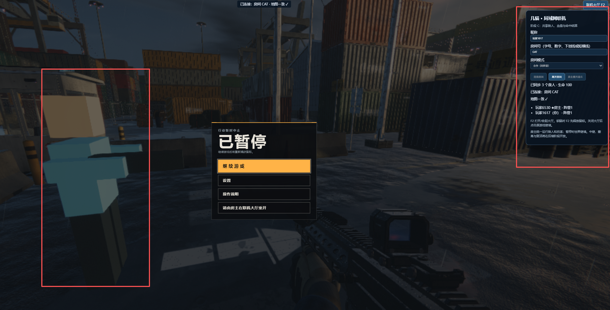
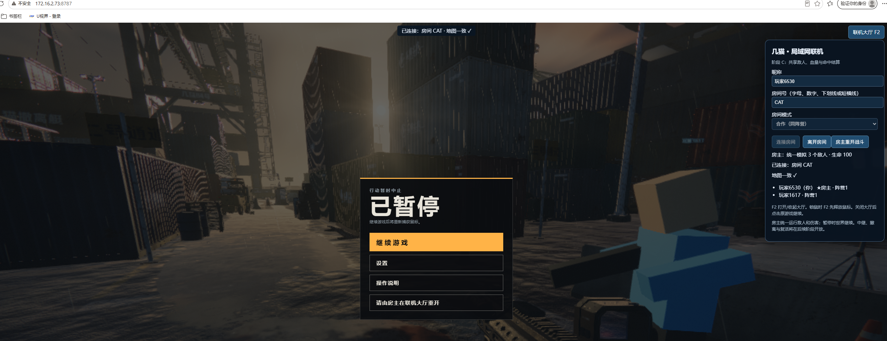

# 几猫 · 局域网联机

**在港区和队友一起对抗机械守卫。**

《几猫》是一个在浏览器里运行的第一人称射击游戏。本项目在原单文件游戏上加入局域网联机：进入同一房间，看到队友的移动与射击，一起攻击同一批机械猎犬和飞鸥守卫。

目前是可以试玩的共享战斗原型，欢迎网友继续接力，把任务、波次、复活和撤离做成完整的合作流程。

[快速开始](#快速开始) · [接力路线图](lan/ROADMAP.md) · [贡献指南](lan/CONTRIBUTING.md) · [详细技术说明](lan/README.md) · [MIT 许可](lan/LICENSE)

## 游戏截图

以下为同一房间的双浏览器实机画面。双方可以看到队友和相同的玩家列表；截图打开了联机大厅，因此显示原游戏的暂停菜单。





## 现在可以玩什么

- **局域网组队：** 昵称、房间号、大厅和地图一致性检查，同机两个浏览器也能测试。
- **看到队友：** 第三人称简模、名字牌、移动插值，以及远程枪火和空间枪声。
- **一起打敌人：** 房主统一运行敌人 AI、判定命中和伤害，各端共享敌人状态。
- **共享战斗状态：** 玩家生命、弹药、换弹和个人击杀统计，支持晚加入及房主整轮重开。
- **轻量运行：** Node.js 服务器零 npm 依赖，原游戏 HTML 保持只读，联机脚本在响应时注入。

当前每轮包含初始的2只飞鸥和1只猎犬。共享任务、后续波次、个人复活和撤离尚未实现；`pvp` 选项目前只做分队，尚无玩家互伤和队伍胜负。20人连接容量已测试，20个真实浏览器的游戏性能尚未验收。

## 快速开始

先安装 [Node.js 20 或更新版本](https://nodejs.org/)，然后执行：

```sh
git clone https://github.com/jixieshi999/aigame.git
cd aigame
node lan/server.js
```

不需要执行 `npm install`。

1. 本机浏览器打开 `http://localhost:8787/`；同网其他设备使用终端打印的局域网地址。
2. 在联机大厅填写昵称和相同的房间号，选择合作模式并连接。第一位加入者成为房主。
3. 按 **F2** 收起大厅，按游戏提示继续；使用 **WASD** 移动、鼠标转向、鼠标左键射击。

房主刷新或离开会结束本轮；当前房主可按 **F2 → 房主重开战斗** 开始新轮。浏览器需要通过上面的 Node 服务器访问，GitHub 页面本身不提供在线游戏服务。局域网访问和 Windows 防火墙说明见[详细运行文档](lan/README.md#启动与访问)。

## 欢迎接力

| 方向 | 想一起完成的内容 |
|---|---|
| D 合作流程 | 共享任务、中继交互、波次、个人复活、全灭与撤离 |
| E 双队对抗 | 玩家命中、队伍计分、出生保护与胜负规则 |
| F 稳定性 | 多设备、弱网、20真实浏览器性能、长时间运行和移动端 |

也欢迎改善玩家外观、动作、声音和联机手感。可以先在 Issue 中认领任务，再提交 PR；[路线图](lan/ROADMAP.md)列出了建议拆分和验收条件，[贡献指南](lan/CONTRIBUTING.md)说明了代码约定与验证方法。

## 开发与验证

在仓库根目录运行零依赖测试：

```sh
node --test lan/test/server.test.js lan/test/client.test.js lan/test/combat.test.js
```

当前已通过32项 Node 测试，并完成共享战斗与真实键鼠的浏览器检查。可选浏览器测试的安装方法、实际验证范围及已知限制见 [lan/README.md](lan/README.md) 和 [C 阶段验证记录](lan/VERIFY-C-20261111.md)。

游戏原文件位于根目录，联机实现、详细文档、测试和截图放在 `lan/`；根目录这份 README 用作 GitHub 首页介绍。请保持原游戏 HTML 不变，通过注入脚本扩展联机能力。

项目采用 [MIT 许可](lan/LICENSE)，保留第三方组件已有的许可声明。
