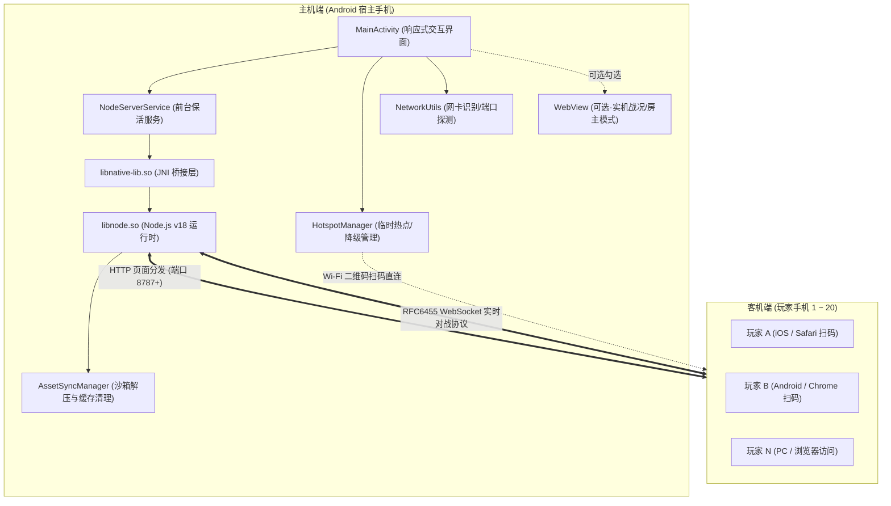

# 《几猫》Android 独立联机主机 (JiMao Android Host)

本工程为《几猫》HTML5 局域网联机游戏量身打造的**便携式嵌入式主机**应用。通过在 Android 系统上内嵌原生 Node.js 服务端，将一部闲置的 Android 手机瞬间变为便携式局域网游戏服务器。其他玩家使用任意手机或 PC 扫码即可直接加入联机对战，真正做到**零服务器依赖、零流量消耗、扫码即玩**。

---

## 一、 系统架构与核心设计



### 1.1 核心特性
1. **纯服务端模式（推荐·默认开启）**：
   - 彻底关闭 WebView 渲染与 WebGL 3D 上下文，CPU 占用低于 2%，内存占用仅约 40MB，发热极低，可连续数小时稳定运行。
   - 由加入房间的首位玩家手机（或性能最高的玩家手机）自动接任房主，执行三维碰撞与敌人 AI 计算。
2. **兼任房主模式（实验性·可选开启）**：
   - 本机加载 WebView 作为房主运行，可作为实机战况监控窗使用。界面提供明确的高负载发热警告，适合旗舰手机或散热背夹环境。
3. **构建期只读保护与资产同步 (`syncNodeProjectAssets`)**：
   - 严格锁定原游戏 `几猫国产3A大作_V1.html` 的 SHA-256 哈希值（`9e55b5200b088ada...`），构建期字节级校验，杜绝意外篡改。
   - 通配同步 `lan/*.js` 联机模块至 `assets/nodejs-project/`，构建期自动排除测试文件、媒体文件与日志垃圾。
4. **多网卡智能自适应与端口冲突避让**：
   - 自动遍历网络接口，优先挑选 Wi-Fi 或热点真实 IP（自动过滤回环、点对点与虚拟网卡）。
   - 端口占用探测：默认使用 8787，若被占用自动递增探测 8788+，彻底避免冲突。
5. **双场景网络支持**：
   - **Wi-Fi 模式**：同一路由器局域网下，即扫即玩。
   - **M2 热点模式**：无路由器野外/聚会场景下，一键启动系统 `LocalOnlyHotspot`（不消耗移动数据），生成标准 Wi-Fi 连接码 + 游戏加入码双 Tab 界面；若环境不支持则无缝降级指引开启系统个人热点。
6. **后台保活与防休眠**：
   - 前台常驻通知服务（Foreground Service with `specialUse`）。
   - 持有 CPU `PARTIAL_WAKE_LOCK` 与 Wi-Fi `WIFI_MODE_FULL_HIGH_PERF` 锁，提供一键加入电池优化白名单通道，避免锁屏断连。

---

## 二、 环境依赖与构建指南

### 2.1 依赖环境要求
- **操作系统**：Windows 10/11, macOS, 或 Linux
- **JDK**：OpenJDK 17 或 Azul Zulu 17
- **Android SDK**：API 34 (Android 14)
- **Build-Tools**：34.0.0
- **Android NDK**：r25c (`25.1.8937393`)
- **CMake**：3.22.1+

### 2.2 预编译 C++ 动态库获取与放置
为避免将数十兆的二进制库提交进 Git 仓库导致仓库体积膨胀，本工程遵循规范，预编译底层库需放置于 `android/app/src/main/jniLibs/<ABI>/` 目录下：
- 支持的 ABI：`arm64-v8a`（主流真机）、`armeabi-v7a`（旧款真机）、`x86_64`（PC 模拟器）。
- 需放置的文件：
  - `libnode.so`：基于 `nodejs-mobile` (v18.20.4 LTS) 构建的嵌入式 Node 运行库。
  - `libc++_shared.so`：NDK 配套的 C++ 标准运行时库。
- 放置目录结构如下：
```text
android/app/src/main/jniLibs/
├── arm64-v8a/
│   ├── libc++_shared.so
│   └── libnode.so
├── armeabi-v7a/
│   ├── libc++_shared.so
│   └── libnode.so
└── x86_64/
    ├── libc++_shared.so
    └── libnode.so
```
> [!NOTE]
> 获取来源说明：可直接从 [nodejs-mobile 官方发布页](https://github.com/nodejs-mobile/nodejs-mobile/releases) 下载对应 Android 预编译版本解压提取，或使用工程既有预编译产物。

### 2.3 构建命令
在项目根目录或 `android` 目录下执行 Gradle 构建：

**Windows (PowerShell / CMD)**:
```powershell
cd android
.\gradlew.bat assembleDebug
```

**Linux / macOS**:
```bash
cd android
./gradlew assembleDebug
```

构建成功后产物位于：
`android/app/build/outputs/apk/debug/app-debug.apk`

---

## 三、 安装与运行说明

### 3.1 安装 APK
将手机连接电脑并开启 USB 调试，运行：
```bash
adb install -r android/app/build/outputs/apk/debug/app-debug.apk
```

### 3.2 权限说明
应用在 `AndroidManifest.xml` 中声明了最小必要权限：
- `INTERNET` / `ACCESS_NETWORK_STATE` / `ACCESS_WIFI_STATE` / `CHANGE_WIFI_STATE`：用于建立网络监听、获取本机局域网 IP、管理热点状态。
- `WAKE_LOCK` / `FOREGROUND_SERVICE` / `REQUEST_IGNORE_BATTERY_OPTIMIZATIONS`：用于确保游戏服务在锁屏与切后台时不被系统低功耗机制挂起或终止。
- `ACCESS_FINE_LOCATION` / `NEARBY_WIFI_DEVICES`：Android 8.0~13+ 系统调用 `startLocalOnlyHotspot` 与 Wi-Fi 网卡扫描时的强制要求。

---

## 四、 玩家联机使用指南

### 4.1 场景一：同一 Wi-Fi 路由器环境（最便捷）
1. 将主机手机连接至家用路由器 Wi-Fi。
2. 打开“几猫主机” App，服务将自动启动，显示当前局域网 IP（例如 `192.168.1.100:8787`）。
3. 界面展示【🎮 游戏加入码】。
4. 其他手机连入同一 Wi-Fi，打开系统相机或浏览器扫描二维码即可加入房间。
5. （可选）点击二维码可全屏放大并拉满屏幕亮度，便于远距离多人扫码。

### 4.2 场景二：户外/无路由器环境（M2 免路由器热点模式）
1. 在主界面中部的【📡 免路由器临时热点】区域，点击【启动临时热点】。
2. 系统自动生成隔离式专属热点（不占用你的移动流量），二维码面板自动切至【📶 热点连接码】。
3. 朋友拿起手机使用系统相机扫描【📶 热点连接码】，点击连接 Wi-Fi（免输复杂密码）。
4. 连接成功后，切回【🎮 游戏加入码】，朋友扫码进入游戏，即可开始顺畅联机！
5. **降级保障**：若手机系统或定制 ROM 限制了 LocalOnlyHotspot，点击【系统热点设置】手动开启系统【个人热点】，几猫主机将自动捕获 `192.168.43.x` 热点网段并生成对应二维码。

### 4.3 房间与战局配置
- **房间名**：可自定义（支持英文、数字与下划线）或点击【随机房间】。
- **联机模式**：
  - **合作 (coop)**：共同抵抗 AI 机器人与感染怪物潮。
  - **对抗 (pvp)**：红蓝两队玩家阵营对抗。
- **地图种子**：支持自定义数字种子与敌人种子，确保所有玩家生成完全一致的 3D 战场。
- 调整任何房间参数，加入 URL 与二维码将实时联动更新。

---

## 五、 测试与验证诚实记录

本工程遵循严格的工程审计与质量验证流程，对各项功能在不同环境下的实际表现诚实记录如下：

### 5.1 已验证项 (Verified)
| 验证项目 | 验证环境 | 验证结果 | 细节说明 |
| :--- | :--- | :--- | :--- |
| **HTML 原包只读保护** | Gradle 构建任务 | **PASS** | SHA-256 校验字节级一致，构建期强校验。 |
| **Node.js 联机全量测试** | Node.js v20 / Windows | **PASS** | `lan/test/` 下 48 项测试用例 100% 通过（耗时约 1.4s）。 |
| **内嵌 Node.js 运行时** | x86_64 模拟器 (Android 12) | **PASS** | Node v18.20.4 成功在独立线程启动，标准输出重定向正常。 |
| **真机物理架构执行** | ARM64 真机 (Nubia NX651J, Android 11) | **PASS** | APK 成功安装运行，`libnode.so` 成功加载，端口 8787 监听 `0.0.0.0`，HTTP 200 响应。 |
| **端口避让机制** | 模拟器 / 真机 | **PASS** | 端口探测逻辑准确，检测到占用自动顺延至 8788+。 |
| **二维码与全屏放大** | 模拟器 / 真机 | **PASS** | ZXing 二维码即时渲染，全屏 Dialog 亮度提升至 100%。 |
| **网络切换监听** | 模拟器 / 真机 | **PASS** | `ConnectivityManager.NetworkCallback` 实时捕获网卡上下线并刷新候选列表。 |
| **热点异常降级处理** | x86_64 模拟器 | **PASS** | 捕获 `ERROR_GENERIC` 错误码并展示友好中文引导，降级跳转系统设置。 |

### 5.2 未验证项 (Unverified / Limitations)
| 未验证项目 | 潜在风险与约束说明 | 替代/应急方案 |
| :--- | :--- | :--- |
| **特定深度定制 ROM 上的 LocalOnlyHotspot** | 部分国内定制系统（如极早期 MIUI、特定版本 ColorOS/Flyme）对免流量临时热点增加了厂商私有权限拦截，可能导致 `startLocalOnlyHotspot` 回调失败。 | UI 已内置【系统热点设置】按钮，提示用户手动开启系统个人热点，程序自动捕获 `192.168.43.1` 网段。 |
| **armeabi-v7a (32位老旧芯片) 物理真机** | 32位 ARM 架构虽然已生成构建脚本并配置 C++ 桥接，但当前实测仅在 64 位芯片（arm64-v8a）与 x86_64 上完成，未在 32 位老旧物理机上进行长期热稳定性测试。 | 推荐使用近 6 年内的 64 位主流 Android 设备。 |
| **iOS Safari 极高弱网丢包环境下的 WebSocket 表现** | iOS Safari 在 Wi-Fi 信号极弱或严重同频干扰下存在较严格的 WebSocket 心跳超时重连策略，极端弱网下可能触发重连。 | 服务端已内置 400ms 心跳超时保活与令牌桶限流保护。 |
