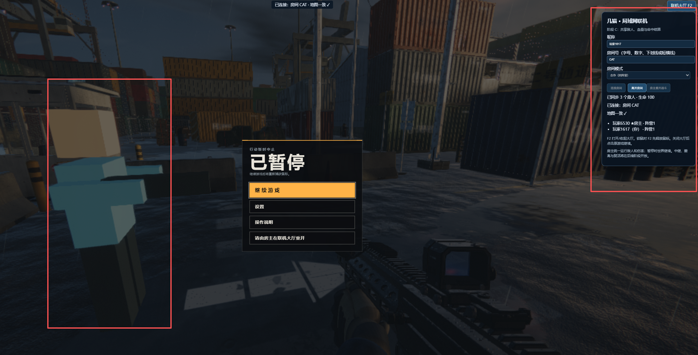
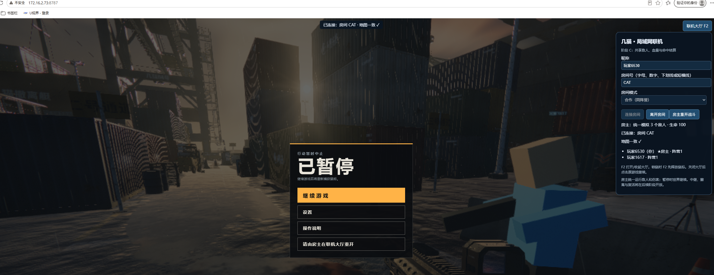

# 几猫 · 局域网联机接力项目

一个单文件浏览器射击游戏的局域网联机原型，欢迎一起把它做成能完整通关的多人游戏。**目前完成 A/B/C：进同一房间、看到队友、一起打同一批敌人。** 后续的共享任务、波次、复活、撤离和 PvP 等你来接力。

双浏览器联机实机截图：双方加入同一房间，可以看到队友和一致的玩家列表。截图中打开了联机大厅，原游戏显示暂停菜单。





[接力路线图](ROADMAP.md) · [贡献指南](CONTRIBUTING.md) · [技术评估](NOTES.md) · [C 阶段验证](VERIFY-C-20261111.md) · [MIT 许可证](LICENSE)

## 三步试玩

1. 克隆或下载本仓库，保留根目录的 `几猫国产3A大作_V1.html` 和 `lan/` 的相对位置，安装 Node.js 20 或更新版本。
2. 在仓库根目录执行 `node lan/server.js`，不需要安装 npm 依赖。
3. 打开终端打印的地址；同机可开两个浏览器测试，同网其他设备打开服务器的局域网地址，填写相同房间号并连接。F2 打开/收起大厅，收起后按游戏提示继续。

默认地址为 `http://localhost:8787/`。这是需要自己运行服务器的局域网项目，GitHub 仓库页面和 GitHub Pages 都不能代替 Node/WebSocket 服务器。

## 当前能玩到哪里

| 阶段 | 状态 | 内容 |
|---|---|---|
| A 通信与地图 | 已实现 | 房间、最多20个连接、版本/种子/地图校验 |
| B 远程玩家 | 已实现 | 简模身体、紧凑名字牌、移动插值、枪火与空间枪声 |
| C 共享战斗 | 已实现 | 房主唯一AI、敌人同步、生命/弹药/击杀、整轮重开 |
| D 合作流程 | 待接力 | 共享任务、中继、波次、个人复活、全灭和撤离 |
| E 双队对抗 | 待接力 | 玩家互伤、队伍胜负、出生和复活规则 |
| F 多设备与性能 | 待接力 | 20真实浏览器、弱网、长时稳定性、移动端 |

20人是连接容量测试结果，尚未完成20真实浏览器的游戏性能验收。优先想接 D 阶段的朋友，请先看[路线图中的验收条件](ROADMAP.md)。

## 项目约定

原游戏 HTML 保持只读，联机代码由服务器在响应内存中临时注入；不改写原文件、不落盘它的完整副本。实现、文档、许可证和测试均放在 `lan/`。根目录的原 HTML 按当前 SHA-256 锁定，其他版本会被拒绝。MIT 许可适用于本项目；第三方组件已有的许可声明保持原样。

## 实现概览

运行时仅用 Node 内置模块，浏览器侧复用原游戏的 Three.js、特效和音频，没有 npm 安装步骤。已提供房间通信、地图检查、远程身体/名字牌，以及 C 阶段的共享敌人、玩家生命、命中、弹药和个人击杀统计。房主浏览器是唯一战斗权威，其他浏览器只显示敌人快照。

**从 A/B 升级后先重启 `node lan\server.js`，再刷新所有浏览器。协议已升级为 v2，旧页面会被拒绝。** 同一台电脑打开两个独立浏览器或窗口，访问同一服务器地址、加入同一房间即可测试。

本版是共享战斗原型：每轮使用原港区初始巡逻的 2 只飞鸥和 1 只猎犬，死亡后不会各端独立刷怪。中继、波次、撤离、全灭结算与个人复活留在 D 阶段；`pvp` 目前只影响分队和颜色，尚无玩家互伤或队伍胜负。

## 启动与访问

需要 Node 20 或更新版本；本机实测 Node v24.22.1。在项目根目录执行：

```powershell
node lan\server.js
# 自定义端口：
node lan\server.js 8788
```

默认监听 `0.0.0.0:8787`，终端打印 localhost 和所有非回环 IPv4 地址。本机打开 `http://localhost:8787/`，同一局域网其他设备使用终端打印的局域网地址。浏览器必须经服务器访问，直接打开原 HTML 不会接入联机。

1. 等原游戏和地图摘要就绪，在右上角大厅填写昵称、相同房间号和模式，点击“连接房间”。第一位成功加入者成为房主。
2. 大厅显示玩家、房主、阵营和地图状态。房间号不区分大小写，只允许 1—32 个字母、数字、下划线或短横线。昵称服务器过滤控制/格式字符并截断至 20 个 Unicode 码点。
3. 加入房间会开始这一轮战斗。F2 收起/打开大厅；鼠标锁定时 F2 先解锁鼠标，原游戏会按已有逻辑暂停。锁鼠期间大厅与按钮隐藏。**个人暂停、打开大厅或房主死亡都不会暂停战斗，玩家仍可能受伤。** 收起大厅后按原游戏提示继续。
4. `seed`、`eseed` 必须与房主一致；不一致时拒绝加入并显示可点击的完整正确 URL。合作同队，双阵营按加入时人数平衡分配，已有玩家不会因他人离开而改队。
5. 构建/种子相同但碰撞或导航摘要不同，双方均看到“地图不一致”提示；此时停止权威模拟和战斗请求，保留远程玩家显示。排查后重新加载；不同地图客户端离开后恢复。
6. 房主可在大厅点击“房主重开战斗”，给所有在线玩家恢复出生状态、生命和弹药，创建新的 roundId。原单人重试/部署按钮在联机期间禁用。个人死亡后等房主重开；本阶段没有个人复活。
7. 房主离开（包括刷新页面）会结束本轮并清除敌人显示；存活玩家仍可移动和转动视角，顶部显示“本轮已结束 · 房主按 F2 重开战斗”。大厅房主顺延，但不自动接管旧 AI；新房主按 F2 打开大厅，点击“房主重开战斗”后才开始新轮。离开房间后恢复原单机流程；重连分配新身份。

可预填并自动加入，例如（将主机名换成终端打印的地址）：

```text
http://localhost:8787/?seed=4207&eseed=9001&lanRoom=CAT&lanName=甲猫&lanMode=coop&lanAuto=1
```

原游戏参数 `q=low` 可降低画面负担；`show=...` 展示模式明确拒绝接入。`lanAuto=1` 在就绪后自动连接；进入 C 战斗时统一初始化本机游戏状态。测试另用原有 `autostart=1`。

## Windows 防火墙

首次启动时允许 Node 访问“专用网络”。如果同网其他设备连接失败，可在管理员 PowerShell 按实际端口执行以下命令（交付过程未修改本机防火墙）：

```powershell
New-NetFirewallRule -DisplayName '几猫 LAN TCP 8787' -Direction Inbound -Action Allow -Protocol TCP -LocalPort 8787 -Profile Private -RemoteAddress LocalSubnet
```

确认设备处于同一网络、IP/端口正确，Wi-Fi 没有客户端隔离。HTTP 和 WebSocket 共用一个 TCP 端口。更换端口时调整防火墙规则。当前是局域网明文 HTTP、无账号认证的房间服务。

## 文件与只读保证

| 文件 | 用途 |
|---|---|
| `server.js` | HTTP、RFC 6455 帧处理、房间与协议校验 |
| `net.js` | 服务器注入的浏览器大厅和表现桥接；含 LAN HTTP 可用的 SHA-256 |
| `combat.js` | 哈希锁定的 C 阶段适配器：房主 AI/伤害，客户端骨骼显示 |
| `combat-protocol.js` | Node 侧战斗快照和事件白名单校验 |
| `NOTES.md` | 敌人模型作为玩家外观的评估，及 C 敌人显示的实现区别 |
| `test/server.test.js`、`test/raw-client.js` | 无第三方库的真实 TCP/HTTP/WebSocket 测试 |
| `test/client.test.js` | 摘要与插值的边界测试 |
| `test/combat.test.js` | 胶囊命中、骨骼编码、射速、协议校验 |
| `test/browser.test.js` | A/B 表现回归检查 |
| `test/browser-combat.test.js` | C 真实游戏、真实鼠标开火、多浏览器战斗检查 |
| `test/controls.test.js` | 真实键鼠检查：活动战斗、房主刷新、重开、暂停恢复 |
| `media/11.png`、`media/22.png` | 双浏览器联机实机截图：客户端与房主视角 |
| `test/artifacts*/` | 本机生成的浏览器证据，不随仓库提交 |
| `ROADMAP.md`、`CONTRIBUTING.md`、`LICENSE` | 接力任务、开发约定与 MIT 许可 |

服务器只读取项目根目录的 `几猫国产3A大作_V1.html`，在响应内存中于最后一个 `</body>` 前插入 `<script src="/net.js" data-build="9e55b5200b088ada"></script>`。不改写源文件、不落盘完整副本。启动时计算完整 SHA-256 并锁定已核验构建；不同构建直接拒绝启动。

原 HTML 完整 SHA-256（交付前再次核验）：

```text
9e55b5200b088adaf8e1152da04efc0d3b25e236e6baf2dee96f81e23e084966
```

仅 `GET/HEAD /`、`GET/HEAD /net.js` 提供内容，允许查询参数；其他路径 404，其他 HTTP 方法 405。`/net.js` 在内存拼接 `combat.js` 和 `net.js`，没有增加静态路由。不会把 URL 映射到磁盘文件。`/` 同时是 WebSocket Upgrade 端点，要求同源 Origin 和 wire version 13；不协商压缩或子协议。favicon 请求 404 是有意的两路由限制。

## 显式协议 v2

所有顶层 JSON 消息包含 `v:2`、`type`。只接受明确的消息白名单。playerId/阵营/服务器时间由连接身份决定；游戏事件总线没有全量转发。

| 方向 / type | 主要字段与行为 |
|---|---|
| S→C `hello` | `build`=服务器算出的 HTML SHA-256 前16位、`maxPlayers:20`、`poseHz:20`、`mapSchema` |
| C→S `join` | `room,nickname,mode,seed,eseed,map`；build 无须也不能由客户端自称，客户端比较 hello 与本页注入的 data-build |
| S→C `joined` | `playerId,roundId,hostId,room,mode,seed,eseed,build,players`；包含已加入者和最近 pose，支持晚加入 |
| S→C `roster` | `roundId,hostId,players`，用于成员及房主变更；每个 player 含身份、昵称、team、服务器 build、map 和最近 pose |
| C→S `pose` | `roundId,seq,pos:[x,y,z],yaw,pitch,crouching,sprinting,ads,alive,reloading` |
| S→C `pose` | 上述白名单字段，加服务器绑定的 `playerId,at`；不回送发送者 |
| C→S `shot` | `roundId,seq,origin:[x,y,z],dir:[x,y,z],muzzle:[x,y,z]`；origin/dir/muzzle 同步复制为数字 |
| S→C `shot` | 加服务器 `playerId,at`，方向归一化；向其他成员播放枪火表现，独立于命中确认 |
| S→Host `shotIntent` | 身份绑定的原始射击意图，包括房主自己的射击；房主统一检测和扣弹 |
| C→S `reload` / `hazard` | `roundId,seq`；hazard 额外含 `reason:fall/rescue,amount`；服务器绑定身份并转发为 `reloadIntent/hazardIntent` |
| Host→S→C `world` | `roundId,seq,enemies,players,bolts`；完整敌人 ID、根位姿、骨骼、HP/目标，玩家生命/弹药/统计，飞鸥弹丸；服务器改写 hostId/at 并缓存供晚加入 |
| Host→S→C `combatEvent` | `roundId,seq,event`；仅允许 hurt、enemyFire、enemyDeath、explosion、shotResult；可靠传输，按序号去重 |
| Host→S `roundReset` | 仅当前房主，最多每2秒一次；服务器生成新 roundId 并清空旧状态 |
| S→C `combatReset` / `authorityStatus` | 前者重新初始化整轮；后者标记 waiting/active/ended，房主3秒不发快照则显示等待 |
| C→S / S→C `leave` | 请求含 roundId；广播含离开的 playerId 与 roundId；实际掉线也清理并广播 |
| S→C `mapStatus` / `mapMismatch` | `roundId,ok,baselineId,mismatched,build,reason`；房间所有成员都会收到，基准为最早加入者 |
| S→C `error` | `code,reason`；例如 `versionMismatch,roomFull,seedMismatch,modeMismatch,invalidMessage`；种子冲突额外返回正确种子/房间/模式 |

`seq` 是递增的安全非负整数，pose/shot/reload/hazard 和权威 world/event 分别计数。射击使用 `(roundId,playerId,seq)` 去重。`at` 为服务器毫秒时间。playerId 在连接期间稳定，重连获得新 ID。roundId 在首建/明确重开时生成；旧轮最近4个 ID 的迟到消息静默丢弃。最后一人离开删除房间。房主离线保留房间成员/种子，本轮 ended，明确重开才重新产生 AI。

pose 向量为有限数字、每分量绝对值 ≤10000，yaw 绝对值 ≤100000，pitch 绝对值 ≤π，ads ∈[0,1]，姿态字段为布尔值。shot 方向长度须在 [.9,1.1]，射击原点须距最近位姿眼部3米内、枪口距射击原点2米内；房主还校验玩家生命、射速、弹药及换弹。普通客户端不能发布敌人状态或伤害确认。位姿和自报落地伤害仍由本机输入，不提供完整移动反作弊；房主本身是受信任权威。

## C 战斗与敌人显示

- 房主独立定时器以30Hz调用原生敌人更新，约10Hz发送全量快照，不依赖个人暂停/死亡的主循环。每个敌人选择在线存活玩家；其同步更新期间用 `try/finally` 切换临时玩家代理，使原生感知、追击、瞄准和近战都指向该玩家，调用结束立即恢复本机玩家引用。
- 非房主不调用敌人更新、不从原池生成实体。显示模型从原 SkinnedMesh 渲染树克隆，重建 Skeleton 并映射至克隆骨头，独立材质，只读共享几何体/纹理。它们不进入敌人列表或伤害碰撞；离开/重开/死亡时只释放自有材质与骨架。骨骼按名称排序，20字节/骨（毫米位置、四元数、缩放，int16 LE/base64），飞鸥13骨、猎犬20骨；根与骨骼使用100ms缓冲插值。
- 本机 `combat.playerShot` 只做静态弹道预测；真正开火事件发送意图，房主使用原静态/敌人 raycast，保留最近遮挡与弱点。枪伤26、弱点2.2倍，12发/秒（令牌桶突发3），弹匣30/备弹150，换弹2.1秒/空弹2.72秒。击杀和命中只归射手，确认后覆盖原单机统计。
- 猎犬死亡立即隐藏房主原模型，并按同一 enemyId 移除其他端显示。飞鸥保留坠落动画，原生坠毁只在房主结算一次，其他端仅回放爆炸特效。敌人射线/弹丸对所有玩家胶囊取遮挡前最近命中；近战扣选定目标；爆炸遍历所有存活玩家，保留视线、距离衰减及原玩家半伤倍率。
- 生命/再生/弹药由房主维护。接收状态调用本机受伤表现，阻止再次产生权威伤害；原本直接写 health 的自动再生每帧被权威健康状态覆盖。没有 PvP 命中；玩家子弹只检测原敌人和静态地图。
- 全量快照使晚加入者直接获取当前敌人 ID/血量，不重新创建满血 AI。每轮敌人 ID 来自房主生命周期，外层 roundId 防止池复用/重开串状态。

## 静态地图摘要规则 `static-v1`

摘要在 `window.__ready` 且 THREE/scene/camera/player/physics/fx/audio/events/weapon 可用后计算；`__fatal`、有效 showcase、关键 stub 或初始化超时会明确提示且不接入。正常版本的 `__G.showcase` 默认为 null，`physics.nav._grid` 实际为函数，本实现调用后读取返回值。

1. 数值全部用 `Math.round(value*1000)` 变成毫米整数；负零统一为 0，非有限数值报错。seed/eseed 读取原游戏 `params`，按与原 PRNG 等价的 int32 规则规范化，默认 4207/9001；字符串 `"0"` 保留零。quality 不进入摘要。
2. 对 `physics.boxes` 的每个盒生成固定顺序数组 `[minX,minY,minZ,maxX,maxY,maxZ,noNav,bulletOnly,playerOnly,surface,tag]`。前三组坐标按上述规则取整，三个布尔值用 0/1，字符串为 `String(value||'')`。
3. 分别对这些数组 `JSON.stringify`，把得到的字符串用 JS 默认 `.sort()` 按 UTF-16 码元排序。再编码 `JSON.stringify(['static-v1',sortedStrings])`，对其 UTF-8 字节做 SHA-256，得 `boxes`。重复盒保留；不依赖原盒列表顺序，不使用本地化排序。
4. 调用 `physics.nav._grid()` 得 `{blocked,w,h,minX,minZ,cell}`。检查 blocked 长度=w*h；按原行优先顺序形成 `JSON.stringify(['static-v1',w,h,round(minX),round(minZ),round(cell),Array.from(blocked,Number)])`，对 UTF-8 做 SHA-256，得 `nav`。
5. map 上报 `{schema:'static-v1',boxes,nav,boxCount,navWidth,navHeight}`；服务器比较这些字段，并以房主首建种子控制准入。build 则始终使用服务器计算结果，不信任客户端声称的 hash。

LAN 的普通 HTTP 页面常没有 `crypto.subtle`，因此 `net.js` 内含纯 JS SHA-256；Node 已对 Unicode、空串、分块边界等与内置 crypto 做交叉测试。摘要只覆盖初始化静态物理/导航，不表示动态敌人、天气或整局随机状态一致。

## 网络与显示预算

- 每消息/数据帧最多64 KiB，分片合计也受限；支持最短16/64位长度，严格检查掩码、RSV、UTF-8、分片顺序、控制帧、关闭码。二进制帧不支持。ping/pong 可穿插文本分片。
- pose 令牌桶20条/秒、突发4；shot 15条/秒、突发6；普通连接所有帧合计120帧/秒、突发160。房主需要确认多人战斗，帧上限512/秒、突发768，world/event 合计400/秒、突发600。reload 2/秒突发2、hazard 3/秒突发4。非法消息前7次报错丢弃，第8次关闭；版本冲突立即提示并关闭。这些是资源上限，不代表20人性能实测结果。
- 15秒内未 join 则关闭；服务器每15秒 ping，10秒未回匹配 pong 则清理，检测粒度1秒。TCP end/error/close 同样删除玩家。连接上限256、同IP64、同IP握手120次/分钟，保护多人同网使用。
- 单连接待发送队列超过256 KiB时丢弃暂态 pose/shot/world，下一份完整 world 可自行恢复；战斗事件不作为暂态丢弃。超过1 MiB关闭慢接收者，避免持续积压。
- 浏览器前台以50ms定时器发送位姿；每远端保留最多32帧，以服务器时间偏移估计+100ms缓冲插值；角度走最短弧，缺帧最多外推100ms且每轴限制1m，随后保持；3秒无更新隐藏模型。
- 根身体只加入世界 layer 0，不加入物理或敌人列表。近处最多约30Hz更新，35m外10Hz，120m外隐藏；死亡隐藏，蹲伏缩短身体，俯仰驱动上半身，换弹倾斜枪身。每个远端只有简模，不创建原武器模块。
- 名字牌用 Canvas `fillText` + Sprite，固定14px文字/21px高的紧凑底框，按实测文字宽度裁切画布，最长200px并省略超长昵称；圆角背景透明度48%，近距离不会放大。50m内显示，按距离/视锥选最多8个，每200ms更新，远处淡出。大厅昵称只用 textContent。
- 远程射击直接调用 `fx.muzzleFlash`、`fx.tracer`、`audio.play('hound_fire',{pos,...})`。实际源码中 `rifle_shot` 固定为 near 声道，即使传 pos 也不会空间化，所以使用原有 world 声道枪声；不伪发 `weapon:fire`、impact 或其他原事件。80m外省略远端枪火，每端合计最多40次/秒。
- 远端玩家离开/断线清除 scene 节点，去重 dispose 自有 geometry/material/CanvasTexture。C适配器对原公开方法做可解除包装，卸载时恢复方法、解除监听和释放自有资源；不修改磁盘HTML。

## 已实测

2026-11-11，Node v24.22.1，本机已安装 Google Chrome + 预装 Playwright；没有 npm install。服务器与普通 JS 测试不依赖 Playwright。

```powershell
node --test lan\test\server.test.js lan\test\client.test.js lan\test\combat.test.js
```

32项测试覆盖握手、加入/离开、20连接容量/第21人拒绝、合作/双队、房主顺延、非法/超长/限流/分片/ping/pong/半开清理/版本拒绝、两路由和原HTML不变；另覆盖host-only战斗通道、意图身份绑定、晚加入、重开隔离、房主离线、65536字节帧、胶囊命中、骨骼编码、射速、多人确认消息预算和退出快照竞态。C最终输出保存于 `test/node-c-results.txt`，A/B历史20项输出保留 `test/node-results.txt`。

可选浏览器检查需要额外的 Playwright；正常运行服务器和上述32项测试都不需要它。在仓库根目录安装测试工具和 Chromium（安装文件由 Git 忽略）：

```powershell
npm install --prefix lan --no-save --package-lock=false playwright
node lan/node_modules/playwright/cli.js install chromium
```

然后运行需要的浏览器检查；也可通过 `PLAYWRIGHT_MODULE` 指定已有模块，通过 `BROWSER_EXECUTABLE` 指定已有 Chrome/Edge：

```powershell
node lan\test\browser.test.js
node lan\test\browser-combat.test.js
node lan\test\controls.test.js
```

脚本启动并关闭自己的一次性服务器和无头浏览器，不依赖8787的服务。下文原始结果和日志路径指维护者的本机生成文件，未提交到公开仓库；运行脚本会生成新的结果，历史数字只代表当时的验收。A/B历史检查使用两个独立浏览器上下文运行真实HTML，验证真实按键移动、鼠标开火传输、身体/Canvas名字牌、昵称按文本呈现、空间枪声、离开回收和房主顺延；第三页验证错误seed纠正链接。通过原始WS客户端提供合成错误摘要，验证地图不一致提示与恢复，这不是两种真实地图生成算法差异的测试。

同 seed4207/eseed9001 的两个页面均生成557个盒，nav=142×124，实测摘要为：

```text
boxes: 4e7c000a15fae8668e123eb6dcacd42c83a8bc7f71fffe6604c769b9b961c292
nav:   33cb047c40dfa373e578bf459673809bfd8d8b7cba48449f5a6f1f67d7efbd19
```

历史证据为 `test/artifacts/browser-results.json`、`client-a.png`、`client-b.png`、`lobby-a.png`。A/B截图通过原 `__setShot` 调整观察相机，移动/射击用真实键鼠。当时接收端监测无weapon:fire/player:hit/enemy:alert或统计副作用；C加入权威伤害后，正常受击事件由房主确认产生，不能把“完全没有受击”继续作为战斗验收条件。音频验证是模块接受world+pos调用，不等于人工听感。

C证据为 `test/artifacts-c/browser-combat-results.json` 和 `client-enemy.png`。战斗检查运行原游戏模块与真实鼠标开火；为复现命中路径，在测试页通过公开接口清理/生成指定敌人、设置玩家位置/瞄准角度、调用弹丸与受伤入口，不修改原HTML。遮挡使用原physics临时盒夹具并立即回收，自然AI选人另行检查。旧页面在其他页面冷启动期间仅降低GPU出帧至2Hz，战斗/网络定时器继续，启动后恢复；此安排不属于多页面性能测量。具体通过项以JSON的 `passed/checks` 为准，覆盖双端猎犬死亡、射手归属、换弹、飞鸥坠毁、AI攻击第二玩家、弹丸伤害、晚加入、房主暂停/死亡/离线及明确重开。

最终C结果：`passed:true`，12组检查通过，1814条pose、29次射击、466份world、40次战斗事件，非法消息0、pageerror0；4次资源404均为 `/favicon.ico`。客户端机械狗截图已查看。A/B历史证据保留；`browser.test.js` 已适配C并分离输出至 `test/artifacts-ab-c/`，本轮没有另行执行这份A/B表现脚本。

本机8787服务已重启并实测返回v2、正确拼接脚本和原构建响应，记录在 `test/live-server-c-results.json`；刷新两端页面即可测试，运行日志为 `server-runtime.log`，进程号保存在 `server-runtime.pid`。再次手动启动前请先关闭已有实例，避免端口冲突。

刷新后键鼠失效修复已通过4组真实输入检查：活动战斗、房主刷新后重新加入已结束轮次、房主明确重开、F2暂停后继续。修复前同样刷新路径仍绘制52帧，但位移/转向均为0；修复后真实鼠标移动和800ms的D键使玩家移动3.074米、视角变化0.273弧度。其余三组位移分别为2.667、3.053、2.846米，全部有实际转向，pageerror=0。结果位于 `test/artifacts-controls/results.json`，修复前记录为同目录 `before-fix.json`。该检查使用一个真实Chrome页面和一个原始WS成员维持房间，清除敌人以排除受击干扰，未改写玩家位置或相机角度；它验证本机控制，不代替多人战斗测试。32项Node回归也全部通过，输出为 `test/node-controls-results.txt`。

8787实测返回的脚本与当前 `combat.js`、`net.js` 拼接结果完全一致，已去除结束轮次冻结控制的分支，并保留紧凑名字牌。证据为 `test/live-controls-results.json`；本次只改注入脚本，无需重启服务，刷新浏览器即可加载。

## 尚未实测与已知边界

- 没有20个真实浏览器的帧率/带宽压测，没有第二台设备的实际局域网连接或 Windows 防火墙放行实测；20人容量依据20个真实TCP/WS会话测试。
- 插值抖动/缺帧/角度边界有算法测试，尚未做真实网络丢包/延迟注入、长时间稳定性或移动端验收。WebSocket 自身有序可靠，拥塞会产生队头阻塞。
- 房主浏览器后台仍受定时器节流/系统挂起影响；3秒无world显示等待，恢复后继续，不承诺后台实时模拟。原fx.update个人暂停时停更，部分粒子可能暂停；网络敌人/身体仍更新。
- 所有玩家在原出生点出生，初始可能重叠。没有远端碰撞、PvP伤害、共享任务/波次/撤离、个人复活、队伍胜负或断线身份恢复。C只有共享战斗和房主整轮重开。
- 位姿与落地自伤请求来自客户端，没有完整移动反作弊、延迟回溯或预测回滚。射线使用房主收到请求时的敌人位置，显示有约100ms插值延迟，高延迟命中手感尚未验收。房主是受信任浏览器，Node没有独立模拟游戏。
- 质量参数不参与静态摘要规则已测试，不代表所有设备/画质组合都做过浏览器比较。程序简模仍是玩家外观，C骨骼克隆只用于共享NPC。
- 20人最终帧率/带宽不能从双客户端或容量测试推定；高并发战斗、多设备、延迟和长时稳定性留待F阶段。

可在浏览器控制台调用只读 `__LAN.snapshot()` 查看连接、摘要、远端可见性/缓冲数、收发计数与回收计数；它不提供修改本机玩家或游戏流程的方法。
